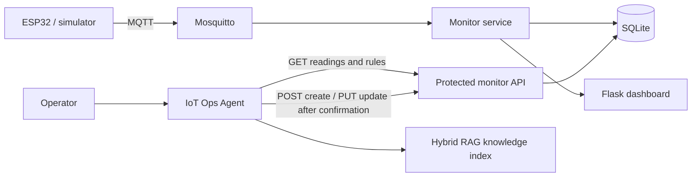

# IoT Ops Agent Platform

**An end-to-end IoT operations demo that connects device telemetry to a guarded natural-language Agent.**

ESP32 or simulated sensors publish readings over MQTT. The monitor service stores and visualizes readings, evaluates configurable alerts, and exposes a Bearer-token-protected API. The Agent uses GLM Function Calling, a Planner/Executor/Verifier loop, and hybrid RAG to answer questions and manage alert rules with explicit confirmation.

## Architecture



The Agent never reads the monitor database directly. Sensor readings and alert rules stay behind the monitor API; rule writes pause for user confirmation and are read back for verification.

## Start the complete demo

Requirements: Docker Compose v2, Python 3.10+, and a GLM API key.

```bash
cp .env.example .env
# Edit .env: add GLM_API_KEY and set a long random IOT_MONITOR_API_TOKEN.
python -m pip install -r requirements.txt
python -m pip install -r agent/requirements.txt
export GLM_API_KEY="your-key"
python agent/build_index.py --doc agent/docs/knowledge --doc agent/README.md
docker compose up --build
```

On PowerShell, set the key for index creation with `$env:GLM_API_KEY="your-key"` before running the Python command. `build_index.py` does not load Compose's `.env` automatically. The generated local index is ignored by Git and is copied into the Agent image during the build.

The simulator publishes one sample per second. Open:

- Dashboard: <http://localhost:5000>
- Agent: <http://localhost:5001>
- MQTT broker: `localhost:1883`

The monitor API listens on port 5002 and requires `Authorization: Bearer <IOT_MONITOR_API_TOKEN>`, including for its health route.

Stop the stack with `docker compose down`; add `-v` only when you also want to remove the local SQLite and MQTT data volumes.

## Ask the Agent

Examples:

- “查询最近 10 条传感器读数。”
- “查看当前告警规则。”
- “创建温度超过 35 度的全局告警规则。”
- “把告警规则 1 的阈值改为 38 度。”

The Agent uses `GET` to query rules, `POST` to create a rule, and `PUT` to update one. Creating or updating a rule requires confirmation in the Agent UI before the request is sent.

## Run tests

```bash
python integration/test_all.py
```

The two suites cover tool planning, schema validation, confirmation gates, rule evaluation and cooldowns, API authentication, database migration, RAG indexing, and retrieval ranking. The runner also starts the monitor API and exercises the Agent's real HTTP client through `GET`, a confirmation-gated `POST`, `PUT`, and read-back verification.

## Repository layout

```text
agent/       Function-calling Agent, hybrid RAG, evaluation and UI
monitor/     MQTT subscriber, SQLite storage, dashboard and protected API
mosquitto/   Local broker configuration for the demo stack
integration/ Cross-project test runner
```

## Security notes

- Keep `.env`, `agent/config.py`, local databases, and generated RAG indexes out of Git.
- The demo broker allows anonymous clients on the local machine; do not expose port 1883 to an untrusted network.
- Use a unique, long `IOT_MONITOR_API_TOKEN` for both Compose services.
- The Agent requires confirmation for rule writes; the standalone monitor API itself is intended for this trusted local demo network.

## Evaluation notes

The Agent's 35-question RAG retrieval set records `Recall@3 = 35/35`, `Top-1 Accuracy = 30/35 (85.7%)`, and `MRR = 0.919`. Its 20-task write-safety smoke run predates the cross-project HTTP integration; treat it as a historical baseline, not a score for this combined release.

## License

See [`agent/README.md`](agent/README.md) and [`monitor/README.md`](monitor/README.md) for the component project documentation.
