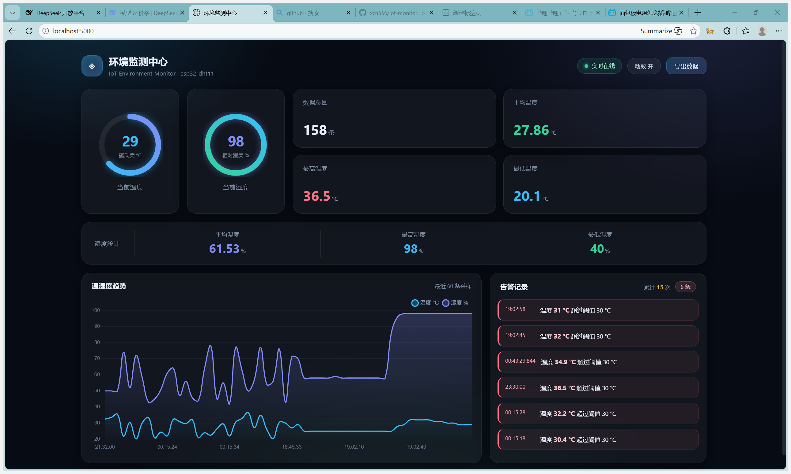
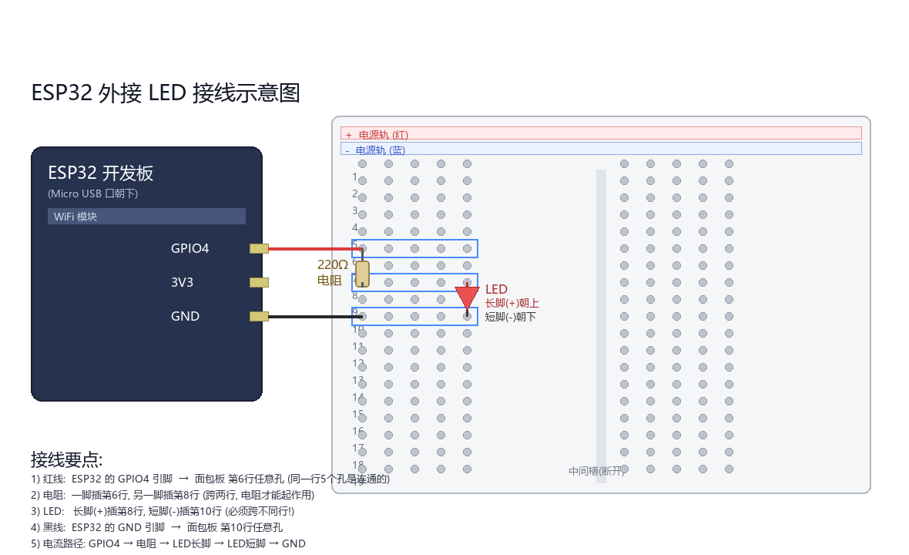
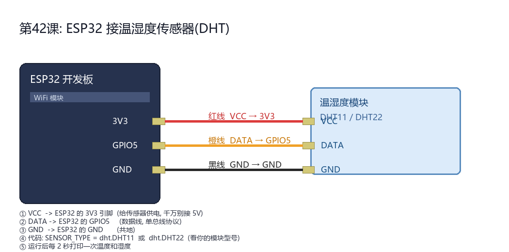

# 物联网温湿度监测系统

一个**端到端**的物联网项目：ESP32 采集真实温湿度 → WiFi/MQTT 上报 → 服务端订阅入库 → 网页大屏实时展示与告警。项目同时支持 Python 模拟设备接入，便于在无硬件时开发调试。



## ✨ 功能特性

- **真实硬件采集**：ESP32 + DHT11 通过 MicroPython 采集温湿度
- **无线通信**：ESP32 经 WiFi 连接 MQTT Broker，以 JSON 格式上报数据
- **模拟设备**：无硬件时可运行 `sensor_publisher.py`，链路与真实设备完全一致
- **数据持久化**：SQLite 保存读数、告警、告警规则和冷却状态，支持表结构演进
- **实时可视化**：Flask + Chart.js 大屏，实时曲线 + 温湿度统计 + 告警列表
- **告警系统**：数据库规则驱动温湿度告警；首次启动会建立全局温度 `>30℃`、冷却 10 秒的默认规则；按规则和设备分别抑制重复告警，可 Webhook 推送（钉钉/企业微信）
- **Agent 集成 API**：提供受 Bearer 令牌保护的读数、统计、告警与告警规则接口，支持创建和修改规则
- **可靠性机制**：MQTT 指数退避重连（1~10 秒）+ 断网本地队列缓存与恢复补发
- **数据导出**：JSON Lines / CSV 导出与日报生成

## 🏗️ 系统架构

```
┌───────────────┐   WiFi    ┌───────────────┐   订阅   ┌───────────────────┐
│ ESP32 + DHT11 │ ────────> │ broker.emqx.io│ ──────> │ dashboard.py      │
│  MicroPython  │   MQTT    │   (云端)       │         │ Flask + Chart.js  │
│  (真实设备)    │           └───────────────┘         └─────────┬─────────┘
└───────────────┘                                               │
        ↑ 可选                                                ▼
┌───────────────┐                                     ┌───────────────────┐
│ sensor_       │ ──── MQTT ────> (同一 broker) ────> │ SQLite            │
│ publisher.py  │                                     │ readings / alerts │
│ (模拟设备)     │                                     └───────────────────┘
└───────────────┘
```

Agent 通过独立的 `agent_api.py` 调用受令牌保护的 HTTP 接口。监测服务维护告警规则并在 MQTT 消息到达时执行，不让 Agent 直接访问 SQLite。

配套的自然语言 Agent 位于 [IoT Operations Agent](https://github.com/XCN666/iot-operations-agent)，它通过本项目 API 查询读数、读取规则，并在用户确认后创建或修改规则。

## 🧰 硬件清单

| 元件 | 用途 |
|------|------|
| ESP32 开发板 | 主控（Wi-Fi + 蓝牙，双核 240MHz，CH340 串口） |
| DHT11 温湿度传感器模块 | 环境温湿度采集（单总线协议） |
| LED + 220Ω 电阻 | GPIO 输出实验 |
| 按键开关 | GPIO 输入实验（内部上拉，低电平有效） |
| 面包板 + 杜邦线 | 电路搭建 |

### 接线示意图

| 外接 LED | DHT11 温湿度传感器 |
|---|---|
|  |  |

## 🛠️ 技术栈

| 类别 | 技术 |
|------|------|
| 设备端 | ESP32 · MicroPython · DHT11 · GPIO |
| 通信协议 | MQTT（paho-mqtt / umqtt.simple）· HTTP |
| 消息中间件 | Mosquitto（本地）· EMQX 公共 Broker（云端） |
| 数据存储 | SQLite3 |
| 服务端 | Python 3.10 · Flask |
| 前端 | Chart.js |
| 数据格式 | JSON / JSON Lines / CSV |
| 开发环境 | WSL2 + Ubuntu 22.04 · Thonny · Git |

## 📁 目录结构

```
iot-lab/
├── esp32/                      # 设备端 (MicroPython)
│   ├── main.py                 # 主程序: WiFi + DHT11 + MQTT 上报
│   ├── wifi_config.example.py  # WiFi 配置模板(真实配置不入库)
│   ├── simple.py               # umqtt.simple MQTT 客户端库
│   └── 01_blink.py ~ 10_wifi_test.py  # 分步实验(点灯/按键/传感器/WiFi)
├── sensor_publisher.py         # 模拟设备: 发布数据
├── data_collector.py           # 服务端: 订阅 + 入库 + 告警
├── dashboard.py                # 网页大屏，同时订阅 MQTT、写入数据库并执行告警
├── agent_api.py                # 提供给 IoT Operations Agent 的受保护 API
├── db.py                       # 数据库模块 (readings / alerts)
├── sensor_lib.py               # 传感器数据模块
├── notify.py                   # 告警推送模块 (Webhook)
├── query_db.py                 # 命令行 SQL 查询工具
├── report.py                   # 日报生成器
├── start_broker.sh             # 一键启动本地 MQTT Broker
├── start_demo.sh               # 一键启动完整演示
├── docs/                       # 接线图与效果截图
└── README.md
```

## 🚀 运行方法

### 服务端（电脑 / WSL）

本地模拟演示（推荐）：

```bash
cd ~/iot-lab
export IOT_MONITOR_API_TOKEN="替换为足够长的随机令牌"
export IOT_DB_PATH="$HOME/iot-lab/logs/sensor.db"
./start_demo.sh
```

脚本会启动本地 Mosquitto、看板、Agent API 和模拟设备。打开 `http://localhost:5000` 查看看板；API 地址为 `http://localhost:5002`。Agent 端设置相同的 `IOT_MONITOR_API_TOKEN` 和 `IOT_MONITOR_API_URL=http://127.0.0.1:5002` 后，再运行 `python3 app.py`。如果 Agent 在 Docker 中运行，API 地址默认使用 `http://host.docker.internal:5002`。

如需使用公共 Broker，可不运行本地 Broker，并在启动看板、API 和模拟设备前统一设置 `IOT_MQTT_BROKER=broker.emqx.io`。`dashboard.py` 已经订阅 MQTT 并负责入库与告警，不要再同时运行 `data_collector.py`，避免重复写入。

### 设备端（ESP32）

1. 用 Thonny 给 ESP32 烧录 MicroPython 固件
2. 把 `esp32/simple.py` 与 `esp32/main.py` 上传到开发板
3. 复制 `esp32/wifi_config.example.py` 为 `esp32/wifi_config.py`，填入 WiFi 名称与密码（仅支持 2.4GHz）
4. 接线：DHT11 的 VCC→3V3、DATA→GPIO5、GND→GND
5. 运行 `main.py`，即可在网页大屏看到真实数据

### 数据处理与排障

```bash
python3 query_db.py                                    # 查看统计
python3 query_db.py "SELECT * FROM alerts ORDER BY id DESC LIMIT 5"
python3 report.py                                      # 生成日报 + CSV
tail -f /tmp/dashboard.log | grep --line-buffered -E "告警|推送"
```

## 💡 关键技术点（面试可展开）

1. **端到端链路设计**：传感器 → MCU → 无线通信 → 云 Broker → 应用服务 → 可视化
2. **MQTT 发布/订阅解耦**：主题分层设计（`iot/设备ID/数据类型`）、通配符订阅、QoS、Retain、遗嘱消息
3. **单总线传感器编程**：DHT11 时序要求、采样间隔限制、型号与数据帧格式差异（DHT11/DHT22 数值缩放不同）
4. **GPIO 输入输出**：上拉电阻消除悬空抖动、按键去抖、低电平有效设计
5. **告警工程设计**：数据库规则驱动字段、比较符和阈值判断；按规则与设备持久化冷却状态，降低重复告警
6. **可靠性机制**：指数退避重连、断网本地队列缓存与恢复补发
7. **数据库设计**：双表结构、PRAGMA + ALTER TABLE 平滑迁移、聚合统计
8. **敏感配置管理**：WiFi 凭据与 Webhook 地址通过 `.gitignore` 隔离，不进入版本库

## 🔭 后续计划

- [ ] 接入 OLED 显示屏，实现本地数据显示
- [ ] 增加历史数据查询页面
- [ ] 支持多设备接入与设备管理

## 👤 作者

徐钏楠 · 2026
